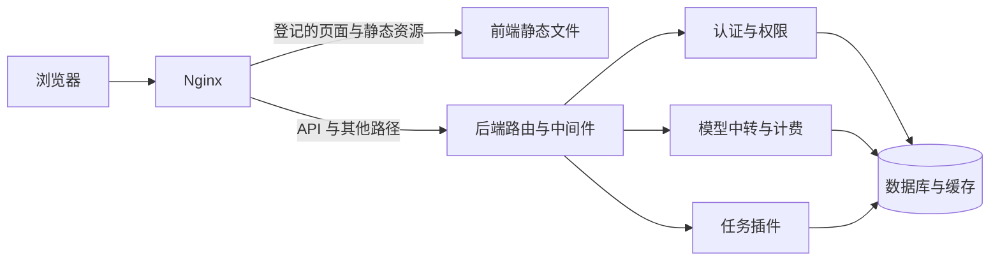

# TauAPI 系统架构

## 仓库分工

| 路径 | 职责 | 构建边界 |
| --- | --- | --- |
| `tauapi-fe/` | React、TypeScript、Rsbuild 控制台 | Bun 构建静态资源 |
| `tauapi-be/` | Gin API、认证、计费、中转和任务插件 | Go 构建纯 API 服务 |
| `tauapi-be/relaykit/` | 协议 DTO 和转换 | 独立 Go 模块 |
| `tauapi-be/tokenkit/` | 令牌计数 | 独立 Go 模块 |
| `tauapi-ops/` | Nginx 路由、构建发布、备份和隔离 QA | 主机脚本 |
| `docs/ai/` | 跨组件契约、共同开发规则、任务记录 | 根目录文档工具读取 |
| 各组件的 `docs/ai/` | 组件开发规范、源码入口和操作步骤 | 由根技术索引统一导航 |

根 `AGENTS.md` 定义共同规则，组件 `AGENTS.md` 补充本组件要求。[技术索引](ai/INDEX.md)由登记表生成。
组件文档引用根契约；前后端开发规则各自维护，共同规则放在根目录。

## 请求流程

前端通过同源相对 URL 调用后端。Nginx 路由分流由 `tauapi-ops/ROUTE_CONTRACT.json` 定义。
后端未匹配的路径进入插件分发，仍未匹配时返回不缓存的 JSON 404。后端不内嵌控制台。

站点名称、Logo、浏览器图标、页脚、首页与法律文本、公告、控制台展示内容、聊天预设、更新源和导航由前端 `tauapi-fe/src/config/site.ts` 管理，随前端独立发布。个人侧栏偏好按账号保存在当前浏览器。后端不再提供站点内容接口或界面配置；认证能力、API 权限、计费单位、汇率与业务数据仍由服务端负责。旧站点配置记录保留但不加载，旧自定义内容需手动迁入前端。

访问令牌只驻留浏览器内存；数据库保存设备会话状态。主从实例共用数据库和密钥，只有主实例执行迁移和后台任务。
共享 Redis 支持撤销传播和共享限流；独立 Redis 的会话缓存按有效 TTL 收敛，限流按实例计算。

## 构建和发布

构建脚本用 `git archive <rev>:tauapi-fe` 或 `git archive <rev>:tauapi-be` 导出指定版本。
每端构建只读取自己的目录。RelayKit 不依赖宿主，TokenKit 不依赖宿主或 RelayKit。
计费样例在两端各存一份，根工具检查内容一致；前端构建读取本地样例。

前端资源发布到 `/_ui/<release>/`，发布后切换入口并保留旧资源供已打开的页面使用。
后端逐个摘除、排空、替换和检查实例。应用回滚与数据库恢复分别处理。
发布前检查前后端兼容性和数据库兼容性，当前自动检查的缺项见[问题清单](ai/KNOWN_GAPS.md)。

## 运行目录

| 用途 | 约定 |
| --- | --- |
| 运行文件 | `/srv/tauapi` |
| 密钥 | `/etc/tauapi` |
| 本地备份 | `/var/backups/tauapi` |
| 后端监听 | 回环端口 3001、3002 |
| QA | 独立项目名、数据卷和密钥；回环端口 8443、3101、3102 |

`tauapi-ops/DEPLOYMENT_STATE.json` 保存带采集时间的部署快照。运维流程见[运维规范](../tauapi-ops/docs/ai/engineering.md)，历史变化见[更新记录](CHANGELOG.md)。
