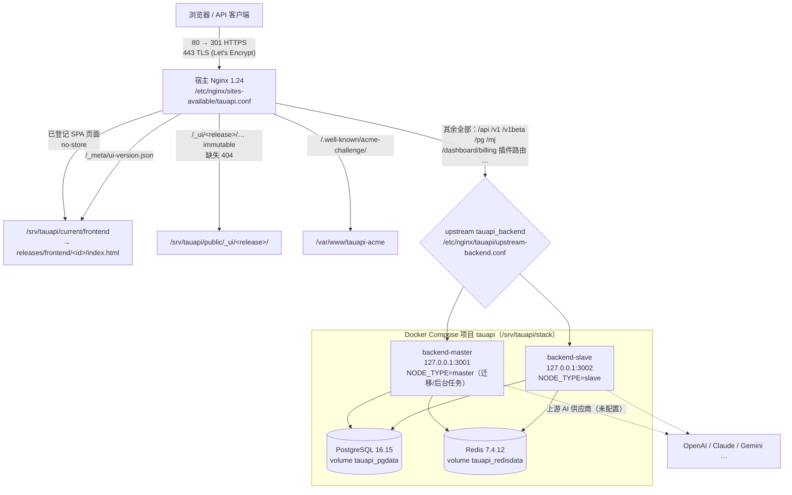
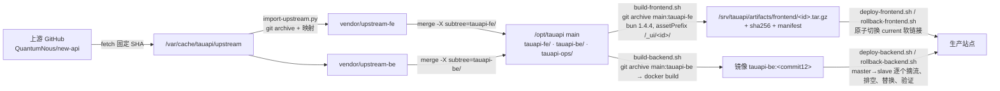

# TauAPI 系统地图（map.md）

> 维护对象：api.victor-tau.xyz 上的 TauAPI（QuantumNous/new-api 前后端分离二开版）
> 更新：2026-11-04 · 基线上游 `ba5f7367797566175a6cd97a748d430af3602a01`
> 仓库：**单一 Git 仓库 `/opt/tauapi`**（tauapi-fe / tauapi-be / tauapi-ops 三个子目录）
> 权威状态以 `tauapi-ops/STATUS.md`、`tauapi-ops/HANDOFF.md`、`tauapi-ops/DEPLOYMENT_STATE.json` 为准；本文件只做导航。
> 本文件有两份：`/opt/tauapi/map.md`（随仓库分发，主副本）与 `/home/tau/new/map.md`（工作目录副本），修改后请保持一致。
> 变更架构、目录、端口或路由时请同步更新第 1–6 节。

---

## 1. 运行时架构



要点：

- 前端是静态制品，由宿主 Nginx 直接提供；后端是纯 API 的 Go 镜像，不内嵌任何前端。
- 分流策略：**明确的前端页面/资源走静态，其余全部交给后端**（后端再由插件分发器处理，未命中返回 JSON 404）。
- 浏览器端所有业务请求使用相对 URL，同源调用 `/api/...`，无跨域。
- PostgreSQL、Redis 只在内部网络 `data`（internal）上，无宿主端口；后端只绑定 127.0.0.1。
- 公网监听：22（SSH，未改动）、80、443。
- 维护模式（`set-site-mode.sh maintenance`）：公网只放行 ACME，其余 503；仅真实回环来源可访问完整站点。

### 1.1 隔离 QA 环境（默认停止）

| 项 | 生产 | QA (`TAUAPI_ENV=qa`) |
| --- | --- | --- |
| Compose 项目 | `tauapi` | `tauapi-qa`（含 profile `qa` 的 mock-upstream） |
| 入口 | 0.0.0.0:443 | 127.0.0.1:8443（同一正式证书，仅回环） |
| 后端 | 3001 / 3002 | 3101 / 3102 |
| 秘密 / 运行目录 | `/etc/tauapi`、`/srv/tauapi` | `/etc/tauapi-qa`、`/srv/tauapi-qa` |
| Nginx 站点 | `sites-available/tauapi.conf` | `sites-available/tauapi-qa.conf`（当前未启用） |

---

## 2. Git 仓库模型与构建发布流水线

单一仓库 `/opt/tauapi`（remote `origin` = `/var/lib/tauapi/git/tauapi.git`）。三个子目录各自保留原有完整历史（通过 subtree 合并导入），但仍是**两个独立的构建/发布单元**：构建脚本只导出 `main:tauapi-fe` 或 `main:tauapi-be`（`git archive`）作为构建上下文，彼此读不到对方目录。

| 引用 | 内容 |
| --- | --- |
| `main` | 全部定制：`tauapi-fe/`、`tauapi-be/`、`tauapi-ops/`、`README.md`、`map.md` |
| `vendor/upstream-fe` | 上游 `web/` 原始导入（拆分布局，位于分支根） |
| `vendor/upstream-be` | 上游后端原始导入（拆分布局，位于分支根） |
| `upstream/fe-ba5f73677975`、`upstream/be-ba5f73677975` | 两份原始导入提交 |
| `release/fe-r1-aade206`、`release/fe-r2-3097ff7`、`release/fe-r3-0dab41b`、`release/fe-r4-db3916f` | 已发布前端版本（指向原前端历史中的提交） |
| `release/be-53c0e999057f`、`release/be-a4231663776e`、`release/be-db3916f928c8` | 已发布后端镜像对应提交 |
| `upgrade/<short-sha>` | `sync-upstream.sh` 生成的上游升级分支（临时） |



- 两类发布单元互不依赖：前端发布不重启后端，后端滚动不改动前端 `current`。
- 所有发布/回滚/切流统一使用部署锁 `/run/lock/tauapi-deploy.lock`。
- 发布成功后在 `/opt/tauapi` 打 `release/<id>` 标签并推送到本地 remote。
- 上游升级：`tauapi-ops/scripts/sync-upstream.sh <sha>` → `upgrade/<short-sha>`，人工测试后再并入 main，**不自动上线**。
- 分发：`git clone /var/lib/tauapi/git/tauapi.git`，或使用备份中的 `tauapi-<时间>.bundle`（`git clone tauapi-….bundle tauapi`）。
- 拆分前的三个独立仓库已归档为 bundle：`/var/lib/tauapi/git/archive-split-20261104/tauapi-{fe,be,ops}.bundle`（旧 bare remote 保留未删）。

---

## 3. 前端端点（浏览器页面，tauapi-fe）

来源：`tauapi-fe/src/routes/`（TanStack Router 文件路由）+ 各 `section-registry.tsx`。这些路径由 Nginx 返回 `index.html`（见 `tauapi-ops/ROUTE_CONTRACT.json`），页面内容由前端渲染。

### 3.1 公共页面（无需登录）

| 路径 | 页面 |
| --- | --- |
| `/` | 首页 |
| `/pricing`、`/pricing/$modelId` | 模型广场 / 模型价格详情 |
| `/rankings` | 排行榜 |
| `/about` | 关于 |
| `/privacy-policy`、`/user-agreement` | 隐私政策 / 用户协议 |
| `/setup` | 初始化向导（仅未初始化时可用，否则跳转 `/`） |

### 3.2 认证

| 路径 | 页面 |
| --- | --- |
| `/sign-in` | 登录（生产只开放密码登录） |
| `/sign-up`、`/register` | 注册（生产已关闭注册） |
| `/forgot-password` | 找回密码（需 SMTP，未配置） |
| `/reset`、`/user/reset` | 重置密码（邮件链接落地页） |
| `/otp` | 二次验证（无待验证挑战时回到登录） |
| `/oauth`、`/oauth/$provider` | OAuth 回调页（成功 / 失败 / 等待） |

### 3.3 控制台（需登录，`_authenticated`）

| 路径 | 页面 | 角色 |
| --- | --- | --- |
| `/dashboard` → `/dashboard/$section` | 仪表盘：`overview` `models` `flow` `users`（users 仅管理员） | 用户 |
| `/keys` | API Keys | 用户 |
| `/playground` | Playground | 用户 |
| `/chat/$chatId`、`/chat2link` | 聊天 / 聊天链接 | 用户 |
| `/usage-logs` → `/usage-logs/$section` | 日志：`common` `drawing` `task` | 用户 |
| `/usage-logs/audit` | 审计日志 | 用户（全量需管理员） |
| `/wallet` | 钱包（充值需支付配置，未配置） | 用户 |
| `/profile` | 个人资料 | 用户 |
| `/security` | 账号安全（密码、2FA、Passkey、会话、访问令牌） | 用户 |
| `/channels` | 渠道 | 管理员 |
| `/models` → `/models/$section` | `metadata` `vendors` `deployments` | 管理员 |
| `/users` | 用户 | 管理员 |
| `/redemption-codes` | 兑换码 | 管理员 |
| `/subscriptions` | 订阅 | 管理员 |
| `/system-info` | 系统信息 | 超级管理员 |
| `/task-plugins` | 任务插件 | 超级管理员 |
| `/errors/$error` | 控制台内错误页 | 用户 |

### 3.4 系统设置（超级管理员，`/system-settings/<分类>/$section`）

| 分类 | section |
| --- | --- |
| `site` | `system-info` `notice` `header-navigation` `sidebar-modules` |
| `auth` | `basic-auth` `oauth` `passkey` `bot-protection` `custom-oauth` |
| `billing` | `quota` `currency` `model-pricing` `group-pricing` `payment` `checkin` |
| `models` | `global` `gemini` `claude` `grok` `model-deployment` |
| `request-policies` | `filtering` `routing` `health` |
| `security` | `rate-limit` `ssrf` `token-limits` |
| `content` | `dashboard` `announcements` `api-info` `faq` `uptime-kuma` `chat` `drawing` |
| `operations` | `behavior` `alerts` `email` `worker` `logs` `performance` `update-checker` |

### 3.5 错误页、旧路径与静态资源

| 路径 | 说明 |
| --- | --- |
| `/401` `/403` `/404` `/500` `/503` | 通用错误页 |
| `/login`、`/forbidden`、`/console/*` | 旧版入口，前端 `resolveLegacyRoute` 迁移到新路径（如 `/console/token` → `/keys`） |
| `/_ui/<release-id>/…` | 版本化不可变 JS/CSS/字体（`max-age=31536000, immutable`，缺失 404） |
| `/_meta/ui-version.json` | 当前前端版本（release_id、commit，no-store） |
| `/favicon.ico` `/logo.png` `/pay-*.png` `/waffo-logo-*.svg` | 未版本化公共文件（no-cache 重新验证） |

---

## 4. 后端 API（tauapi-be）

来源：`tauapi-be/router/*.go`。除 3.x 中的前端路径外，所有请求都进入后端；未匹配路由先交给插件分发器，再返回 JSON 404（`Invalid URL`，`no-store`）。
鉴权方式：**Dashboard** = `Authorization: Bearer <短期 access token>`（登录获得）+ HttpOnly refresh Cookie；**Relay** = `Authorization: Bearer sk-…`（API Key）。

### 4.1 管理面 `/api`（router/api-router.go，前端控制台使用）

| 前缀 | 主要接口 | 鉴权 |
| --- | --- | --- |
| `/api/status` `/api/setup` `/api/notice` `/api/about` `/api/home_page_content` `/api/pricing` `/api/rankings` `/api/models` `/api/uptime/status` `/api/user-agreement` `/api/privacy-policy` `/api/ratio_config` `/api/perf-metrics` | 站点状态、初始化（GET/POST setup）、公开内容 | 公开（setup POST 仅未初始化时） |
| `/api/status/test` | 数据库连通检查 | 管理员 |
| `/api/user/login` `/login/2fa` `/login/verify` `/login/passkey/*` `/register` `/auth/refresh` `/auth/logout` | 登录、二次验证、Passkey、刷新、登出 | 公开 / Refresh Cookie + Origin |
| `/api/verification` `/api/reset_password` `/api/user/reset` `/api/verify*` | 邮件验证码、找回密码、敏感操作二次确认 | 公开 / 用户 |
| `/api/oauth/:provider` `/api/oauth/state` `/api/oauth/wechat` `/api/oauth/telegram/*` `/api/oauth/email/bind*` | OAuth 登录与绑定 | 公开 / 用户 |
| `/api/user/self` `/self/groups` `/sessions` `/access_tokens` `/passkey*` `/2fa/*` `/checkin` `/oauth/bindings` `/setting` `/aff*` | 个人资料、会话、个人访问令牌、2FA、签到 | 用户 |
| `/api/user/topup*` `/pay` `/amount` `/stripe/*` `/creem/pay` `/waffo*/…` `/epay/notify` | 充值与支付回调 | 用户 / 回调 |
| `/api/user/`（GET/POST/PUT/DELETE）`/search` `/manage` `/:id/*` `/2fa/stats` | 用户管理 | 管理员 |
| `/api/token/*` | API Key 增删改查、查看密钥、批量 | 用户 |
| `/api/usage/token` | 按 Key 查询用量 | API Key |
| `/api/log/*` `/api/log/self*` `/api/log/export` `/api/audit` `/api/audit/self` | 调用日志、统计、导出、审计 | 用户 / 管理员 |
| `/api/data/*` | 仪表盘数据（用量、用户、flow） | 用户 / 管理员 |
| `/api/mj/*` `/api/task/*` | 绘图任务、异步任务记录与产物 | 用户 / 管理员 |
| `/api/channel/*`（router/channel-router.go） | 渠道管理：列表/搜索/测试/余额/批量/标签/拉取模型/多 Key/上游更新/Ollama/Codex | 管理员（按权限点） |
| `/api/models/*` `/api/vendors/*` `/api/deployments/*` `/api/prefill_group/*` `/api/group` | 模型元数据、供应商、模型部署、预设分组 | 管理员 |
| `/api/redemption/*` | 兑换码 | 管理员 |
| `/api/subscription/*` `/api/subscription/admin/*` | 订阅套餐与用户订阅 | 用户 / 管理员 |
| `/api/option/*` | 系统选项、请求策略、模型定价、支付合规 | 超级管理员 |
| `/api/custom-oauth-provider/*` | 自定义 OAuth 提供商 | 超级管理员 |
| `/api/performance/*` `/api/system-info/*` `/api/system-task/*` `/api/ratio_sync/*` | 性能、实例信息、系统任务、倍率同步 | 超级管理员 |
| `/api/plugin/task/*` `/api/task_plugin_options` | 任务插件管理、市场 | 超级管理员 / 管理员 |
| `/api/authz/*`（router/authz-router.go） | 权限目录 | 管理员 |
| `/api/stripe/webhook` `/api/creem/webhook` `/api/waffo/webhook` `/api/waffo-pancake/webhook/:env` `/api/subscription/epay/*` | 支付回调（未配置） | 签名校验 |

### 4.2 中转面（router/relay-router.go 等，API 客户端使用）

| 路径 | 协议 |
| --- | --- |
| `GET /v1/models`、`/v1/models/:model` | OpenAI 模型列表 |
| `POST /v1/chat/completions`、`/v1/completions`、`/v1/responses`、`/v1/responses/compact`、`GET /v1/responses` | OpenAI Chat / Responses（支持 SSE 流式） |
| `GET /v1/realtime` | OpenAI Realtime（WebSocket） |
| `POST /v1/messages` | Anthropic Claude Messages |
| `POST /v1/embeddings`、`/v1/engines/:model/embeddings`、`/v1/rerank`、`/v1/moderations`、`/v1/edits` | 向量、重排、审核 |
| `POST /v1/images/generations`、`/v1/images/edits`（插件协议路由）、`/v1/images/variations` | 图像 |
| `POST /v1/audio/transcriptions`、`/translations`、`/speech` | 音频 |
| `/v1/files*`、`/v1/fine-tunes*` | 文件与微调 |
| `POST /v1/alpha/search`、`/v1/tools/search`、`/v1/tools/fetch` | 搜索/工具 |
| `GET /v1beta/models`、`/v1beta/openai/models`、`POST /v1beta/models/*path` | Google Gemini 原生 |
| `POST /pg/chat/completions` | Playground（控制台登录态） |
| `/mj/*`、`/:mode/mj/*`（如 `/fast/mj/…`） | Midjourney 代理 |
| `/v1/video/generations*`、`/v1/videos/*`（router/video-router.go） | 视频生成 |
| `/v1/tasks/:key*`（router/task-router.go） | 统一异步任务接口 |
| `GET /dashboard/billing/subscription`、`/dashboard/billing/usage`（及 `/v1/` 前缀）（router/dashboard.go） | OpenAI 兼容账单查询，**Nginx 中优先于 `/dashboard` 页面** |

### 4.3 动态插件路由（plugins/tasks/*，router/plugin-router.go）

JS 任务插件在运行时声明自己的原生路由，未被静态路由命中的请求由插件分发器处理：

| 前缀 | 插件示例 |
| --- | --- |
| `/ali/api/v1/…`、`/api/v1/services/aigc/…`、`/api/v1/tasks/:task_id` | 阿里百炼（图像/视频） |
| `/api/v3/contents/generations/tasks*`、`/api/v3/images/generations` | 豆包 / 火山 |
| `/ent/v2/*`、`/v2/*` | Vidu |
| `/suno/submit/:action`、`/suno/fetch*` | Suno |
| `/hailuo/v1/query/…`、`/v1/video_generation`、`/v1/query/video_generation` | 海螺 |
| `/text-to-video/*`、`/image-to-video/*`、`/omni-video/*` | Kling |
| `/v1/projects/:project/locations/:location/publishers/google/models/:model` | Vertex AI |
| `/tasks`、`/v1beta1/…`、`/v1/videos/*` | 其他视频/任务插件 |

保留命名空间（插件不得占用）：`/_ui/`、`/_meta/`、`/.well-known/acme-challenge/` 以及第 3 节登记的前端页面前缀。`generate-nginx.py --check-plugins` 会检查冲突。

---

## 5. 主机目录总览

```
/opt/tauapi/                      TauAPI 单一 Git 仓库（remote: /var/lib/tauapi/git/tauapi.git）
├── .git/
├── README.md                     仓库说明
├── map.md                        本文件（主副本）
├── tauapi-fe/                    前端（React 19 + Rsbuild + Tailwind 4）
├── tauapi-be/                    后端（Go 1.26.10，纯 API）
└── tauapi-ops/                   运维（脚本、模板、证据、交付文档）

/var/lib/tauapi/git/
├── tauapi.git                    当前唯一 bare remote
├── archive-split-20261104/       拆分时期三个仓库的完整 bundle（只读归档）
└── tauapi-{fe,be,ops}.git        旧 bare remote（已停用，保留以便追溯）
/var/cache/tauapi/upstream/       上游只读缓存（固定 SHA）

/srv/tauapi/                      生产运行目录
├── stack/compose.yml             由 tauapi-ops/templates/compose.yml 渲染
├── stack/images.env              当前镜像（含 digest 锁定的 PG/Redis）
├── releases/frontend/<id>/       完整前端 release（index.html、manifest、SHA256SUMS）
├── current/frontend -> releases/frontend/<id>
├── public/_ui/<id>/              版本化不可变静态资源
├── artifacts/{frontend,backend}/ 构建制品与清单
├── maintenance/index.html        维护页
└── state/                        site-mode、active-upstream、发布日志、backend-release.json

/srv/tauapi-qa/                   QA 运行目录（结构同上）
/etc/tauapi/                      生产秘密（root 0600）：postgres.env redis.env app-secrets.env backend.env initial-admin.json
/etc/tauapi-qa/                   QA 秘密 + QA 测试账户/令牌
/var/backups/tauapi/              db/*.dump（pg_dump -Fc）、git/tauapi-*.bundle、meta/*.tar.gz（仅本机）
/var/www/tauapi-acme/             ACME webroot

/etc/nginx/
├── sites-available/tauapi.conf           生成：generate-nginx.py（勿手改）
├── sites-available/tauapi-qa.conf
├── sites-available/tauapi-bootstrap.conf 初始引导维护站点（未启用）
├── conf.d/tauapi-common.conf             http 级 map/geo/log_format
├── modules-enabled/90-tauapi-main.conf   worker_shutdown_timeout 660s
└── tauapi/  upstream-backend.conf proxy-backend.conf security-headers.conf

/etc/letsencrypt/live/api.victor-tau.xyz/ 证书；renewal-hooks/deploy/newapi-nginx-reload.sh
/etc/systemd/system/                      tauapi-stack.service、tauapi-backup.{service,timer}
/etc/logrotate.d/tauapi-nginx
/var/log/nginx/tauapi.{access,error}.log  仅记录路径，不含查询串/凭据

Docker 卷：tauapi_{pgdata,redisdata,master_data,slave_data}
          tauapi-qa_*（QA）、newapi_*（改名前遗留，可选清理）

/home/tau/new/                    工作目录
├── GOAL.md                       任务与验收合同
├── map.md                        本文件（副本）
└── new-api-official/             用户 clone 的上游代码（未修改）
```

---

## 6. 仓库文件树（/opt/tauapi）

```
/opt/tauapi/
├── README.md, map.md, .gitignore
│
├── tauapi-ops/                    运维
│   ├── HANDOFF.md                 交付说明（入口文档）
│   ├── STATUS.md                  当前阶段与恢复入口
│   ├── PLAN.md, DECISIONS.md      阶段门槛 / 关键决策
│   ├── UPSTREAM_LOCK.json         上游 SHA、工具链、导入布局
│   ├── ROUTE_CONTRACT.json        前端路由/资源/后端例外/保留命名空间
│   ├── DEPLOYMENT_STATE.json      当前前端 release、后端镜像（collect-evidence 生成）
│   ├── UI_INVENTORY.csv           77 行页面/动态 section 覆盖矩阵
│   ├── config/logrotate/tauapi-nginx
│   ├── config/systemd/tauapi-stack.service, tauapi-backup.{service,timer}
│   ├── docs/MINIMALIST_FLAT.md    UI 设计实施规则
│   ├── templates/compose.yml      postgres / redis / backend-master / backend-slave / mock-upstream(qa)
│   ├── scripts/
│   │   ├── lib.sh, lib-frontend.sh          公共函数、环境（prod|qa）、部署锁、发布标签
│   │   ├── preflight.sh                     只读主机检查
│   │   ├── import-upstream.py               固定 SHA → vendor/upstream-{fe,be}
│   │   ├── sync-upstream.sh                 上游升级分支（subtree merge，不上线）
│   │   ├── build-frontend.sh, build-backend.sh   git archive main:<子目录> → 制品
│   │   ├── generate-nginx.py                由路由契约生成站点配置
│   │   ├── set-site-mode.sh, set-upstream.sh
│   │   ├── bootstrap-stack.sh, bootstrap-admin.py
│   │   ├── deploy-frontend.sh, rollback-frontend.sh, prune-frontend.sh
│   │   ├── deploy-backend.sh, rollback-backend.sh
│   │   ├── smoke.sh, smoke-auth.py
│   │   ├── backup.sh, restore-check.sh
│   │   ├── collect-evidence.sh
│   │   └── verify-independent-builds.sh     各子目录单独导出后构建/测试
│   ├── qa/                        仅用于隔离 QA（mock 上游、夹具、截图、演练脚本）
│   └── evidence/                  ACCEPTANCE / RELEASE_DRILLS / UI_REVIEW / SUMMARY-prod / ui/*；raw/ 不入库
│
├── tauapi-fe/                     前端（源自上游 web/）
│   ├── package.json, bun.lock, .node-version, .npmrc     bun@1.4.4
│   ├── rsbuild.config.ts          assetPrefix /_ui/<TAUAPI_RELEASE_ID>/、开发代理
│   ├── vitest.config.ts, tsconfig*.json, .oxlintrc.json, .oxfmtrc.json, components.json
│   ├── index.html                 主题预加载脚本
│   ├── AGENTS.md, UPSTREAM_ROOT_AGENTS.md, UPSTREAM.json
│   ├── LICENSE, NOTICE, THIRD-PARTY-LICENSES.md, VERSION
│   ├── .agents/                   shadcn-ui 等技能与规则
│   ├── testdata/contracts/frontend_simulation.json   计费表达式契约快照
│   ├── public/                    favicon、logo、支付图标
│   ├── scripts/                   版权头、格式化、i18n 同步、oxlint 规则
│   └── src/
│       ├── main.tsx, routeTree.gen.ts
│       ├── routes/                (auth) (errors) _authenticated/ about oauth pricing rankings setup …
│       ├── features/              about auth channels chat dashboard errors home keys legal model-pricing
│       │                          models performance-metrics playground pricing profile rankings
│       │                          redemption-codes security setup subscriptions system-info
│       │                          system-settings system-update task-plugins usage-logs users wallet
│       ├── components/            ui/ layout/ data-table/ ai-elements/ 共享业务组件
│       ├── hooks/                 含 use-release-update-notice.ts（新版本提示）
│       ├── lib/                   http-client（相对 URL）、auth-session、motion、format、currency …
│       ├── context/, stores/      主题 Provider、Zustand
│       ├── i18n/locales/          en zh zh-TW fr ru ja vi
│       └── styles/                theme.css（扁平 token）、theme-presets.css、index.css
│
└── tauapi-be/                     后端（上游除 web/、electron/ 外全部）
    ├── main.go                    启动、优雅退出，无 go:embed
    ├── go.mod, go.sum             module github.com/QuantumNous/new-api，Go 1.26.10
    ├── Dockerfile                 纯 API 镜像（builder/runtime 均 digest 锁定）
    ├── Dockerfile.dev, docker-compose*.yml, makefile
    ├── REPOSITORY_SPLIT.md, UPSTREAM.json, AGENTS.md, README*.md, LICENSE, NOTICE
    ├── .github/workflows/         CI（无前端步骤）
    ├── router/                    main.go（SetRouter + SetFallbackRouter → JSON 404）、api-router、
    │                              channel-router、authz-router、relay-router、dashboard、video-router、
    │                              task-router、task-plugin-protocol-router、plugin-router
    ├── middleware/  controller/  service/  model/  relay/
    ├── setting/  common/  constant/  dto/  types/  logger/  oauth/  i18n/
    ├── pkg/                       billingexpr（含契约 fixture 原件）、jsplugin、wsmanager …
    ├── plugins/tasks/             alibaba doubao google hailuo jimeng kling sora sunoapi vertex-ai vidu xai
    ├── relaykit/                  独立 Go 模块（协议 DTO/转换）
    ├── tokenkit/                  独立 Go 模块（token 计数）
    └── docs/  e2e/  assets/  bin/
```

---

## 7. 端口与流量速查

| 端口 | 绑定 | 用途 |
| --- | --- | --- |
| 22 | 0.0.0.0 / [::] | SSH（未改动） |
| 80 | 0.0.0.0 / [::] | ACME + 301 → HTTPS |
| 443 | 0.0.0.0 / [::] | 生产站点 |
| 3001 / 3002 | 127.0.0.1 | backend-master / backend-slave |
| 8443 | 127.0.0.1 | QA 站点（启用 QA 时） |
| 3101 / 3102 | 127.0.0.1 | QA 后端（启用 QA 时） |
| 5432 / 6379 | 仅容器内部网络 | PostgreSQL / Redis |

## 8. 常用入口

| 想做的事 | 命令（在 `/opt/tauapi/tauapi-ops`） |
| --- | --- |
| 查看现状 | `cat STATUS.md`；`sudo docker ps`；`readlink /srv/tauapi/current/frontend`；`git -C /opt/tauapi log --oneline -5` |
| 提交改动 | `cd /opt/tauapi && git add -A && git commit -m … && git push origin main --tags` |
| 发布前端 | `scripts/build-frontend.sh --release-id <id>` → `sudo scripts/deploy-frontend.sh <id>` |
| 回滚前端 | `sudo scripts/rollback-frontend.sh [<id>]` |
| 发布后端 | `scripts/build-backend.sh` → `sudo scripts/deploy-backend.sh tauapi-be:<commit12>` |
| 回滚后端 | `sudo scripts/rollback-backend.sh` |
| 上游升级 | `scripts/sync-upstream.sh <sha>` → 在 `upgrade/<sha>` 上构建测试 → 合并 main |
| 冒烟检查 | `sudo scripts/smoke.sh --public` |
| 备份 / 恢复演练 | `sudo scripts/backup.sh`；`sudo scripts/restore-check.sh` |
| 维护模式 | `sudo scripts/set-site-mode.sh maintenance`（恢复：`live`） |
| 刷新状态文件 | `sudo scripts/collect-evidence.sh` |
| 打包分发 | `git -C /opt/tauapi bundle create tauapi.bundle --all` |
